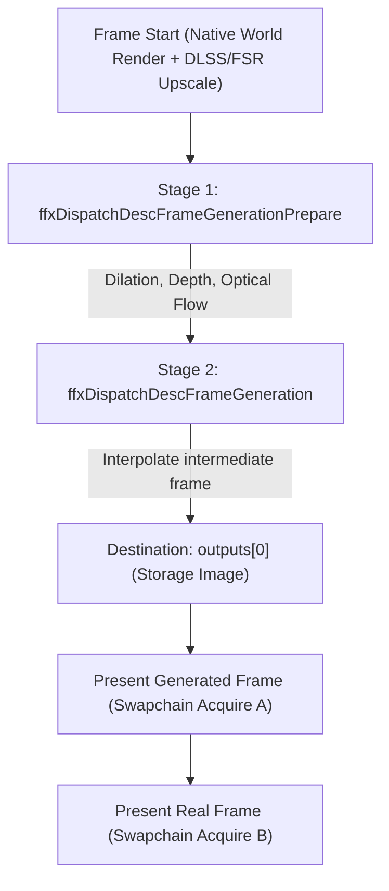

# Reflexium Frame Generation Reference

> **Document Status:** Research & Architectural Specification (Round 2 Revision).  
> **Reflexium Target:** Minecraft 26.3 Fabric (Renderpearl backend, Java 25, native Vulkan).  
> **Hardware Target Platform:** NVIDIA GeForce RTX 5070 (Blackwell architecture, Driver release branch 615+, e.g. 617.42) & AMD RDNA 2/3/4 architectures.  
> **Current Local Verification Date:** October 2026.  
> **Scope Ownership:** This document establishes vendor specifications, API structures, hardware boundaries, driver prerequisites, licensing boundaries, and empirical findings. Reflexium does not yet implement frame generation. Implementation scope decisions for DLSS FG remain pending parent diagnostic probe results.

---

## Verified runtime evidence

The parent capability probe supersedes the draft's unmeasured blanket blockers. On RTX 5070 and
617.42, the production NGX runtime reports FG available and MultiFrameCountMax=5 (up to 6x total),
and successfully creates an FG feature. AMD's signed Vulkan runtime creates an FG context too.
See [probe scope and results](FRAME_GENERATION_PROBE.md). Minecraft-device acceptance, generation,
UI composition and presentation timing remain unverified. Do not confuse static MFG with Streamline
Dynamic MFG, which currently lists Vulkan as unsupported.

Current primary scheduling sources:

- [NVIDIA Streamline FG guide](https://github.com/NVIDIA-RTX/Streamline/blob/main/docs/ProgrammingGuideDLSS_G.md)
- [Streamline manual Vulkan hooks](https://github.com/NVIDIA-RTX/Streamline/blob/main/docs/ProgrammingGuideManualHooking.md)
- [VkSetPresentConfigNV](https://docs.vulkan.org/refpages/latest/refpages/source/VkSetPresentConfigNV.html)
- [AMD FSR3 guidance](https://gpuopen.com/fidelityfx-super-resolution-3/)

NVIDIA's present-metering extension spaces a batch of up to eight presents in the driver. It is
provisional, capability-gated, and used by the current Streamline implementation. AMD provides
its own Vulkan swapchain replacement and presentation scheduler. Presentation must use a proven
pacing path; issuing several presents and merely multiplying Minecraft's FPS counter is not validation.
## 1. Primary Sources & Local Evidence Base

Every technical claim in this document is categorized under one of four evidentiary levels:
* `[LOCAL INSPECTION]`: Verified directly from headers, binaries, or documents in the Reflexium repository.
* `[DOCUMENTED]`: Verified from official vendor programming guides, SDK specifications, or Khronos registry entries.
* `[ARCHITECTURAL INFERENCE]`: Logical deduction from Vulkan submission and presentation queue mechanics, explicitly labeled.
* `[UNKNOWN - PENDING RUNTIME PROBE]`: Runtime behavior that cannot be confirmed without live driver probing.

### 1.1 NVIDIA Primary Sources
* **DLSS Frame Generation Programming Guide** `[LOCAL INSPECTION]`  
  * File: `native/deps/DLSS/doc/DLSS-FG Programming Guide.pdf` (Revision 1.5.0).
  * Direct Link: [NVIDIA Developer DLSS](https://developer.nvidia.com/rtx/dlss)
* **DLSS Super Resolution Programming Guide** `[LOCAL INSPECTION]`  
  * File: `native/deps/DLSS/doc/DLSS_Programming_Guide_Release.pdf`.
* **DLSS SDK C/C++ Headers and Binaries (Pinned Version 310.9.1.0)** `[LOCAL INSPECTION]`  
  * Headers: `native/deps/DLSS/include/nvsdk_ngx.h`, `nvsdk_ngx_defs.h`, `nvsdk_ngx_defs_dlssg.h`, `nvsdk_ngx_helpers_dlssg_vk.h`.
  * Production Binaries: `native/deps/DLSS/lib/Windows_x86_64/rel/nvngx_dlssg.dll` (7,460,976 bytes).
* **NVIDIA Reflex Vulkan Extension Specification (`VK_NV_low_latency2`)** `[DOCUMENTED]`  
  * Specification: Khronos Registry Revision 3.  
  * Direct Link: [VK_NV_low_latency2 Specification](https://registry.khronos.org/vulkan/specs/latest/man/html/VK_NV_low_latency2.html)
* **NVIDIA RTX UI Developer Guidelines** `[LOCAL INSPECTION]`  
  * File: `native/deps/DLSS/doc/RTX UI Developer Guidelines.pdf`.
* **NVIDIA Streamline Framework** `[DOCUMENTED]`  
  * Repository: [NVIDIA GameWorks Streamline GitHub](https://github.com/NVIDIAGameWorks/Streamline)

### 1.2 AMD Primary Sources
* **AMD FidelityFX SDK v1.1.4 / FSR 3.1.4 API Headers** `[LOCAL INSPECTION]`  
  * Headers: `native/deps/FidelityFX-SDK-v1.1.4/ffx-api/include/ffx_api/ffx_framegeneration.h`, `ffx_api_types.h`, `ffx_api.h`.
  * Vulkan Backend: `native/deps/FidelityFX-SDK-v1.1.4/ffx-api/include/ffx_api/vk/ffx_api_vk.h`.
* **AMD FidelityFX Signed Vulkan Prebuilt Runtime** `[LOCAL INSPECTION]`  
  * Binary: `native/deps/FidelityFX-SDK-v1.1.4/PrebuiltSignedDLL/amd_fidelityfx_vk.dll`.
  * License: `native/deps/FidelityFX-SDK-v1.1.4/sdk/LICENSE.txt` (MIT License).
* **AMD GPUOpen FSR 3.1 Overview and Guidelines** `[DOCUMENTED]`  
  * Direct Link: [AMD GPUOpen FSR 3](https://gpuopen.com/fidelityfx-super-resolution-3/)
  * Direct Link: [AMD FidelityFX SDK on GPUOpen](https://gpuopen.com/fidelityfx-sdk/)
* **AMD Community Hardware and Baseline Framerate Recommendations** `[DOCUMENTED]`  
  * Direct Link: [AMD Community FSR 3 Announcement & Recommendations](https://community.amd.com/t5/gaming/amd-fsr-3-now-available/ba-p/634265)

### 1.3 Empirical Reference Repositories
* **MCVR (Vulkan Ray Tracing Renderer for Minecraft, GPLv3)** `[LOCAL INSPECTION]`  
  * Path: `C:/Users/Ryan/source/refs/mcvr` (specifically `src/core/render/dlss_frame_generation.cpp`, `fsr_frame_generation.cpp`, `render_framework.cpp`, and `modules/world/dlss/dlss_wrapper.cpp`).
* **Radiance (Fabric Mod Companion to MCVR)** `[LOCAL INSPECTION]`  
  * Path: `C:/Users/Ryan/source/refs/radiance`.

---

## 2. NVIDIA DLSS Frame Generation and Multi-Frame Generation (MFG)

### 2.1 Architecture: Raw NGX DLSS-G vs NVIDIA Streamline

| Dimension | Raw NGX DLSS-G (`nvsdk_ngx_helpers_dlssg_vk.h`) | NVIDIA Streamline (`sl.dlss_g`) |
| :--- | :--- | :--- |
| **Interface Style** | Low-level C API (`NGX_VK_CREATE_DLSSG`, `NGX_VK_EVALUATE_DLSSG`) `[LOCAL INSPECTION]` | High-level C++ plugin middleware wrapping swapchains `[DOCUMENTED]` |
| **Vulkan Support** | Direct evaluation into application `VkCommandBuffer` `[LOCAL INSPECTION]` | Supported via Streamline Vulkan Interposer (`sl.interposer`) `[DOCUMENTED]` |
| **Swapchain Ownership** | Full application ownership. App controls acquires, presents, and fences `[DOCUMENTED]` | Streamline wraps `VkSwapchainKHR`, managing presentation and pacing internally `[DOCUMENTED]` |
| **Java FFM Compatibility** | High. Fits Reflexium's existing native bridge (`reflexium_ngx.cpp`) `[LOCAL INSPECTION]` | Low. Requires hooking swapchain function pointers and heavy C++ scaffolding |
| **Multi-Frame (MFG) Exposure** | Exposed via parameters in `nvsdk_ngx_defs_dlssg.h` `[LOCAL INSPECTION]` | Exposed via Streamline DLSS-G constants (`sl::DLSSGOptions`) `[DOCUMENTED]` |

Reflexium already utilizes the raw NGX pathway for Super Resolution. Therefore, the raw NGX bridge is the natural architectural fit if NVIDIA DLSS-G is integrated.

### 2.2 Access Control and Allowlist Status

* **Super Resolution vs Frame Generation Access Rules `[DOCUMENTED]`:**
  * For DLSS Super Resolution (`NVSDK_NGX_Feature_SuperSampling`), NVIDIA drivers permit execution with custom or arbitrary application IDs (e.g. Reflexium's GUID).
  * For DLSS Frame Generation (`NVSDK_NGX_Feature_FrameGeneration`), NVIDIA documentation states that production NGX runtimes check application identification.
* **Header Definition of Feature Denial `[LOCAL INSPECTION]`:**
  * In `native/deps/DLSS/include/nvsdk_ngx_defs.h`:
    ```c
    NVSDK_NGX_Result_Fail = 0xBAD00000,
    NVSDK_NGX_Result_FAIL_FeatureNotFound = NVSDK_NGX_Result_Fail | 4, // 0xBAD00004
    ...
    // NVIDIA has restricted the use of this feature in the current application.
    // Contact NVIDIA for further information.
    NVSDK_NGX_Result_FAIL_Denied = NVSDK_NGX_Result_Fail | 17, // 0xBAD00011 (decimal 3134193681)
    ```
* **Runtime Allowlist Status for Reflexium `[UNKNOWN - PENDING RUNTIME PROBE]`:**
  * Whether the installed driver on Ryan's RTX 5070 enforces an application allowlist check on `javaw.exe` returning `NVSDK_NGX_Result_FAIL_Denied` (0xBAD00011) or succeeds has **not been tested** in this session.
  * Parent is executing an isolated diagnostic probe to determine this conclusively. Scope decisions must remain deferred until that diagnostic completes.

### 2.3 Vulkan Multi-Frame Generation (MFG) Specification

* **Official Header Definitions `[LOCAL INSPECTION]`:**
  * In `native/deps/DLSS/include/nvsdk_ngx_defs_dlssg.h` (lines 350-360):
    ```c
    // Output Capability Parameters (access via GetDeviceCapabilityParameters)
    // The maximum number of generated frames supported by the feature (e.g. 3 for 4x)
    // If 1 or not set, multiframe is not supported
    #define NVSDK_NGX_DLSSG_Parameter_MultiFrameCountMax "DLSSG.MultiFrameCountMax"

    // InParameters
    // uint32_t, Total of Number Frames expected to Interpolate for given Real-Frame Pair. For 4x, this is 3. For 2x, this is 1.
    #define NVSDK_NGX_DLSSG_Parameter_MultiFrameCount    "DLSSG.MultiFrameCount"
    // uint32_t, Current inner frame index. For 4x, this is 1, 2, and 3. For 2x, this is 1.
    #define NVSDK_NGX_DLSSG_Parameter_MultiFrameIndex    "DLSSG.MultiFrameIndex"
    ```
  * In `native/deps/DLSS/include/nvsdk_ngx_helpers_dlssg_vk.h` (lines 80-84):
    ```c
    if (pInDlssgOptEvalParams)
    {
        NVSDK_NGX_Parameter_SetUI(pInParams, NVSDK_NGX_DLSSG_Parameter_MultiFrameCount, pInDlssgOptEvalParams->multiFrameCount);
        NVSDK_NGX_Parameter_SetUI(pInParams, NVSDK_NGX_DLSSG_Parameter_MultiFrameIndex, pInDlssgOptEvalParams->multiFrameIndex);
    ...
    ```
* **Multipliers and Hardware Mapping `[DOCUMENTED]`:**

| Multiplier Mode | Native Frames | Generated Frames | Target Refresh Rate | Official Hardware Requirement |
| :--- | :--- | :--- | :--- | :--- |
| **2x Mode** | 1 | 1 | 120 Hz - 144 Hz | RTX 40 Series & RTX 50 Series |
| **3x Mode** | 1 | 2 | 165 Hz - 240 Hz | RTX 50 Series (Blackwell OFA) |
| **4x Mode** | 1 | 3 | 240 Hz - 360 Hz+ | RTX 50 Series (Blackwell OFA) |
| **Dynamic MFG** | 1 | 1 to 3 variable | Variable Refresh Rate displays | RTX 50 Series |

* **Local Machine Capability `[UNKNOWN - PENDING RUNTIME PROBE]`:**
  * While the Vulkan headers fully define multi-frame evaluation parameters, whether the installed driver reports `MultiFrameCountMax > 1` on Vulkan on this RTX 5070 system is unconfirmed without running the diagnostic probe.

### 2.4 Hardware, OS, and Driver Prerequisites

* **Hardware Prerequisites `[DOCUMENTED]`:**
  * Standard DLSS Frame Generation (2x): GeForce RTX 40-Series or RTX 50-Series with Optical Flow Accelerator (OFA). Older Turing (RTX 20) and Ampere (RTX 30) architectures return `NVSDK_NGX_Result_FAIL_FeatureNotSupported` (0xBAD00001).
  * Multi-Frame Generation (3x, 4x): GeForce RTX 50-Series (Blackwell) with 5th-generation Tensor Cores and Blackwell OFA.
* **Operating System & Scheduling `[DOCUMENTED]`:**
  * Windows 10 (version 2004 / build 19041+) or Windows 11.
  * Hardware-Accelerated GPU Scheduling (HAGS) must be enabled in Windows Graphics Settings. If disabled, NGX initialization fails with `NVSDK_NGX_Result_FAIL_PlatformError` (0xBAD00002).
* **Driver Baseline `[DOCUMENTED]`:**
  * DLSS 3 Frame Generation: Driver 526.98 or higher.
  * DLSS 4 Multi-Frame Generation: Release 615+ driver branch (e.g. 617.42).

### 2.5 Required & Optional Input Buffers (`NGX_VK_EVALUATE_DLSSG`)

* **Mandatory Buffers `[LOCAL INSPECTION]` (`nvsdk_ngx_helpers_dlssg_vk.h`):**
  1. `pBackbuffer`: Fully rendered scene color buffer (`VK_IMAGE_LAYOUT_SHADER_READ_ONLY_OPTIMAL`). Formats: `VK_FORMAT_R8G8B8A8_UNORM`, `VK_FORMAT_B8G8R8A8_UNORM`, or `VK_FORMAT_R16G16B16A16_SFLOAT`.
  2. `pDepth`: Scene depth buffer matching render or display resolution (`VK_IMAGE_LAYOUT_SHADER_READ_ONLY_OPTIMAL`). If inverted depth (reverse-Z) is used, pass `NVSDK_NGX_DLSSG_Parameter_DepthInverted = 1`.
  3. `pMVecs`: 2D motion vector buffer (`VK_IMAGE_LAYOUT_SHADER_READ_ONLY_OPTIMAL`). Standard format: `VK_FORMAT_R16G16_SFLOAT`. Encodes $(x, y)$ displacement in screen space from current frame to previous frame.
  4. `pOutputInterpFrame`: Target storage image for generated frame (`VK_IMAGE_LAYOUT_GENERAL`, usage must include `VK_IMAGE_USAGE_STORAGE_BIT`).
* **Optional Buffers for UI Recomposition `[LOCAL INSPECTION]`:**
  1. `pHudless`: Color buffer rendered before HUD/GUI draw calls.
  2. `pUI` / `pUIAlpha`: Separate texture containing UI color and alpha.
* **Camera Transform Parameters `[LOCAL INSPECTION]` (`NVSDK_NGX_DLSSG_Opt_Eval_Params`):**
  * Matrices (column-major $4 \times 4$ unjittered floats): `cameraViewToClip`, `clipToCameraView`, `clipToPrevClip`, `prevClipToClip`.
  * Camera Vectors: Camera world position $(x, y, z)$, camera right vector, camera up vector, camera forward vector.
  * Pinhole & Projections: Vertical FOV in radians, near plane, far plane, subpixel jitter offset $(x, y)$, and motion vector scale.

### 2.6 Synchronization, Layout Transitions, and Reflex Attribution

* **Image Layout Transitions `[DOCUMENTED]`:**
  * Inputs must be transitioned to `VK_IMAGE_LAYOUT_SHADER_READ_ONLY_OPTIMAL` with access mask `VK_ACCESS_2_SHADER_READ_BIT` under `VK_PIPELINE_STAGE_2_COMPUTE_SHADER_BIT`.
  * Output interpolated image must be transitioned to `VK_IMAGE_LAYOUT_GENERAL` with `VK_ACCESS_2_SHADER_WRITE_BIT`.
* **Reflex Mandate (`VK_NV_low_latency2` Rev 3) `[DOCUMENTED]`:**
  * NVIDIA RTX UI Guidelines mandate that when DLSS Frame Generation is enabled, NVIDIA Reflex Low Latency must be active and locked.
  * In Rev 3 of `VK_NV_low_latency2`, `VkLatencySubmissionPresentIdNV` is chained into `VkSubmitInfo2.pNext` to distinguish real rendered submissions from generated auxiliary presentations.
  * `vkLatencySleepNV` must execute only once per real simulation tick at the frame start, never between generated and real presentations.

---

## 3. AMD FidelityFX Super Resolution 3.1 Frame Generation

### 3.1 Version Evolution & Architectural Decoupling

* **FSR 3.0 (Monolithic) `[DOCUMENTED]`:** Tied upscaling and frame generation into a coupled DirectX 12 pipeline relying on swapchain wrapping.
* **FSR 3.1 / SDK 1.1.4 (Decoupled & Modular) `[LOCAL INSPECTION]`:**
  * Upscaling (`ffx_upscale.h`) is decoupled from frame generation (`ffx_framegeneration.h`) via the modular `ffx-api` architecture.
  * Frame generation can be evaluated on arbitrary inputs: native resolution, FSR upscaled, Intel XeSS upscaled, or NVIDIA DLSS Super Resolution upscaled images.
  * Native Vulkan support is provided via `amd_fidelityfx_vk.dll` and `ffx_api_vk.h`.
* **FSR 4 & Project Redstone `[DOCUMENTED]`:**
  * FSR 4 introduced machine-learning upscaling for RDNA 4 (RX 9000 series) in March 2025 (developer SDK released August 20, 2025).
  * AMD released Project Redstone on December 10, 2025, unifying ML upscaling, ML frame generation, neural ray regeneration, and radiance caching. FSR 4.1 expanded support to RDNA 3 in mid-2026.
  * *Reflexium Pinned Target:* Reflexium bundles AMD FidelityFX SDK v1.1.4 (FSR 3.1.4, MIT licensed), which is the verified open-source Vulkan runtime in `native/deps/FidelityFX-SDK-v1.1.4`.

### 3.2 Hardware Boundaries and Framerate Guidance

* **Hardware Compatibility Matrix `[DOCUMENTED]` (AMD GPUOpen Guidelines):**

| GPU Vendor | Officially Supported Minimum | Officially Recommended |
| :--- | :--- | :--- |
| **AMD** | Radeon RX 5000 Series (RDNA 1) | Radeon RX 6000 Series (RDNA 2) and above |
| **NVIDIA** | GeForce RTX 20 Series (Turing) | GeForce RTX 30 Series (Ampere) and above |

* **Baseline Framerate Recommendation `[DOCUMENTED]`:**
  * AMD explicitly recommends a baseline performance of **~60 FPS native/upscaled** prior to frame generation.
  * *Important distinction:* This is an engineering recommendation to avoid interpolation artifacts and noticeable input lag. It is **not** an API validation failure or hard runtime cutoff.

### 3.3 API Dispatch Workflow (`ffx_framegeneration.h`)

FSR 3.1 Frame Generation operates through a two-stage compute dispatch `[LOCAL INSPECTION]`:



1. **Context Creation (`ffxCreateContextDescFrameGeneration`) `[LOCAL INSPECTION]`:**
   * Bound to Vulkan backend via `ffxCreateBackendVKDesc` (`ffx_api_vk.h`).
   * Optional linked struct `ffxCreateContextDescFrameGenerationHudless` allows the HUDless backbuffer format (e.g. `RGBA8_UNORM`) to differ from the swapchain format (e.g. `BGRA8_UNORM`).
2. **Context Configuration (`ffxConfigureDescFrameGeneration`) `[LOCAL INSPECTION]`:**
   * `flags = FFX_FRAMEGENERATION_FLAG_NO_SWAPCHAIN_CONTEXT_NOTIFY` enables application-managed swapchain presentation without proxy hooks.
   * `frameID`: 64-bit monotonically incrementing integer.
3. **Prepare Dispatch (`ffxDispatchDescFrameGenerationPrepare`) `[LOCAL INSPECTION]`:**
   * Records depth dilation and optical flow passes into `VkCommandBuffer`.
   * Inputs: `depth`, `motionVectors`, `renderSize`, `jitterOffset`, `motionVectorScale`, `frameTimeDelta`.
   * Linked structure `ffxDispatchDescFrameGenerationPrepareCameraInfo` passes camera world position, up vector, right vector, and forward vector.
4. **Generation Dispatch (`ffxDispatchDescFrameGeneration`) `[LOCAL INSPECTION]`:**
   * Performs frame interpolation into `outputs[0]`.
   * Inputs: `presentColor` (rendered frame), `outputs[0]`, `numGeneratedFrames = 1`, `reset`, `frameID`.

### 3.4 Decoupled Pairing: AMD FSR Frame Generation + NVIDIA DLSS Super Resolution

Because FSR 3.1 is decoupled at the API level `[LOCAL INSPECTION]`:
* Reflexium can upscale Minecraft world geometry using DLSS Super Resolution via `reflexium_ngx.dll`.
* The upscaled color buffer and motion vectors are forwarded directly into `ffxDispatchDescFrameGenerationPrepare` and `ffxDispatchDescFrameGeneration`.
* The interpolated frame is produced by AMD's compute runtime (`amd_fidelityfx_vk.dll`) without triggering NVIDIA DRS profile checks.
* **Compatibility:** This pipeline functions across NVIDIA RTX GPUs, AMD Radeon GPUs, and Intel Arc GPUs, combining NVIDIA's CNN/transformer upscaler with open-source frame generation.

---

## 4. Empirical Reference Analysis: Radiance and MCVR

### 4.1 Architectural Inspection of MCVR (`C:/Users/Ryan/source/refs/mcvr`)

MCVR is a standalone Vulkan ray tracing renderer for Minecraft (GPLv3). Inspection of its source provides empirical insights into Vulkan frame generation mechanics `[LOCAL INSPECTION]`:

* **DLSS Provider (`dlss_frame_generation.cpp`):**
  * Links `nvsdk_ngx_helpers_dlssg_vk.h` and calls `NGX_VK_CREATE_DLSSG` and `NGX_VK_EVALUATE_DLSSG` directly on the Vulkan command buffer.
  * Queries feature availability via `ngxParams_->Get(NVSDK_NGX_Parameter_FrameGeneration_Available, ...)`.
  * Passes camera view/projection matrices, camera orientation vectors, and pinhole offsets.
* **FSR Provider (`fsr_frame_generation.cpp`):**
  * Uses FidelityFX SDK with Vulkan backend.
  * Dispatches `DispatchDescFrameGenerationPrepare` with camera info followed by `DispatchDescFrameGeneration`.
  * Passes `FFX_FRAMEGENERATION_FLAG_NO_SWAPCHAIN_CONTEXT_NOTIFY` for app-managed swapchain presentation.

### 4.2 Presentation and Swapchain Mechanics in MCVR (`render_framework.cpp`)

In `render_framework.cpp` (lines 1318-1352), when `evaluation.presentGenerated` is true `[LOCAL INSPECTION]`:
1. MCVR acquires an additional present image via `acquireAdditionalPresentImage`.
2. The generated frame (`evaluation.generatedColors[0]`) is blitted into swapchain image $A$ and submitted to `vkQueuePresentKHR`.
3. MCVR acquires a second swapchain image via `acquireAdditionalPresentImage`.
4. The real frame (`evaluation.realColor`) is blitted into swapchain image $B$ and submitted to `vkQueuePresentKHR`.

### 4.3 Architectural Analysis of Submission & Pacing Hazards

* **Sequential Submission Hazard `[ARCHITECTURAL INFERENCE]`:**
  * MCVR executes the present acquire, blit, and `vkQueuePresentKHR` for the generated frame, and immediately proceeds to acquire, blit, and present the real frame in the same execution tick without intermediate timer delays or present wait synchronization.
  * On unbuffered or variable refresh rate (VRR) displays, submitting both frames back-to-back within sub-millisecond proximity creates a burst presentation hazard (clustering frames together), causing uneven scanout intervals unless display hardware buffering or VSync caps smooth the queue.
* **Reflex Integration Absence `[LOCAL INSPECTION]`:**
  * MCVR does not integrate `VK_NV_low_latency2` present attribution markers with its frame generation loop, omitting low-latency frame pacing.

### 4.4 Legal Boundaries: Clean-Room MIT Implementation

* **License Differences:**
  * MCVR is licensed under **GPLv3**.
  * Reflexium is licensed under the permissive **MIT License**.
* **Permissible vs Restricted Usage:**
  * *Permissible Interoperability Reuse:* Standard C function signatures, Vulkan extension constants, and vendor SDK structure definitions (e.g. Khronos structs, NGX structs, FSR API structs) are functional interfaces necessary for interoperability and are not protected by copyright monopolies under merger doctrine and fair use (*Google LLC v. Oracle America, Inc.*).
  * *Strictly Prohibited:* MCVR's creative C++ implementation code, custom helper classes (`DlssFrameGenerationHelper`), shader code, and proprietary algorithms cannot be copied, ported, or transcribed into Reflexium. Doing so would create a derivative work and violate GPLv3 boundaries.
  * *Conclusion:* Reflexium's implementation must be written completely clean-room from Khronos, NVIDIA, and AMD primary documentation and official SDK headers.

---

## 5. Concrete Gap Analysis against Reflexium Codebase

| Component | Status in Reflexium | Code Location | Technical Gap & Required Actions |
| :--- | :--- | :--- | :--- |
| **Native NGX FG Bridge** | MISSING | `native/reflexium_ngx.cpp` | Has DLSS SR (`rx_create`, `rx_evaluate`), but lacks FG functions. Must add `rx_dlssg_create`, `rx_dlssg_evaluate`, and `rx_dlssg_release`. |
| **Native FSR FG Bridge** | MISSING | `native/reflexium_fsr.cpp` | Has FSR upscaling (`rx_fsr_create`, `rx_fsr_evaluate`), but lacks FG functions. Must add `rx_fsr_fg_create`, `rx_fsr_fg_prepare`, and `rx_fsr_fg_dispatch`. |
| **Interpolated Image Allocation** | MISSING | `OutputImage.java` | Allocates only upscaled image (`mainRenderTarget`). Must allocate intermediate destination image (`interpolatedImage`) with `VK_IMAGE_USAGE_STORAGE_BIT`. |
| **HUDless Color Buffer Retention** | PARTIAL | `UpscalingRenderer.java:264` | World renders to internal target and upscales before GUI. Pre-GUI buffer must be retained as `hudlessImage` before GUI draw calls overwrite it. |
| **Separate UI Texture / Alpha** | MISSING | `GuiRendererMixin.java` | GUI renders directly into backbuffer without an isolated UI texture or alpha buffer. Required for clean UI recomposition. |
| **Swapchain Image Depth** | RECOMMENDATION | `VulkanLifecycle.java:78` | Current `minImageCount = Math.max(3, ...)`. Recommending expanding to 4 images to minimize acquire wait bubbles under double-present. |
| **Double Present Interception** | MISSING | `VulkanGpuSurfaceMixin.java` | Surface mixin intercepts single `vkQueuePresentKHR`. Must support acquiring and presenting two distinct images per render loop. |
| **High-Precision Frame Pacing** | MISSING | `ReflexController.java` | Manages frame-start sleep (`vkLatencySleepNV`), but lacks present-interval timing to space generated and real presentations evenly. |
| **Reflex Submission Attribution** | PARTIAL | `VulkanLifecycle.java:101` | Chains `VkLatencySubmissionPresentIdNV` on submit for single present. Must chain proper present ID or auxiliary tag for generated presentations. |
| **Camera Vectors & Unjittered Matrices** | PARTIAL | `dlss_motion.fsh`, `DlssMath.java` | Tracks projection and view matrices, but does not marshal camera world position, up/right/forward vectors, and FOV into native structs. |

---

## 6. Implementation Pathways & Feasibility Assessment

### Pathway 1: AMD FSR 3.1.4 Decoupled Vulkan Frame Generation (Recommended Baseline)
* **Feasibility:** Fully unblocked at API and licensing level.
* **Strengths:**
  * Uses AMD's signed Vulkan runtime (`amd_fidelityfx_vk.dll`), already bundled in `native/deps/FidelityFX-SDK-v1.1.4/`.
  * Open source (MIT License), maintaining complete licensing harmony with Reflexium.
  * Cross-vendor compatibility (runs on RTX 20/30/40/50 series and AMD Radeon RX 5000+).
  * Can be decoupled and combined with Reflexium's existing DLSS Super Resolution upscaler.
* **Blockers / Work Remaining:**
  * Must implement native C exports in `native/reflexium_fsr.cpp`.
  * Must implement Vulkan double-present loop and intermediate image management in Java.

### Pathway 2: NVIDIA Raw NGX DLSS-G (Standard 2x Frame Generation)
* **Feasibility:** Scope decision deferred pending parent diagnostic probe results.
* **Strengths:**
  * Hardware accelerated on Ada Lovelace (RTX 40) and Blackwell (RTX 50) GPUs.
  * Native raw NGX API fits Reflexium's existing `reflexium_ngx.cpp` architecture.
* **Blockers / Uncertainties:**
  * Driver allowlist verification on `javaw.exe` remains unconfirmed on host system.
  * Requires strict integration of `VK_NV_low_latency2` revision 3 present IDs.

### Pathway 3: NVIDIA DLSS 4 Multi-Frame Generation (MFG 3x, 4x+) on Vulkan
* **Feasibility:** Scope decision deferred pending parent diagnostic probe results.
* **Strengths:**
  * Supported in DLSS SDK 310.9.1.0 headers (`nvsdk_ngx_defs_dlssg.h`, `nvsdk_ngx_helpers_dlssg_vk.h`).
* **Blockers / Uncertainties:**
  * Runtime availability of `MultiFrameCountMax > 1` on Vulkan under current driver 617.42 is unknown until the diagnostic probe completes.

---

## 7. Frame Pacing and Presentation Timing Dynamics

### 7.1 The Interleaving Presentation Model

Standard single-frame presentation vs 2x frame generation presentation interleaving `[ARCHITECTURAL INFERENCE]`:

```
Standard (1x):
Render Frame 0 ──► Acquire A ──► Present Real 0 (t = 0)
Render Frame 1 ──► Acquire B ──► Present Real 1 (t = 16.67ms @ 60 FPS)

Frame Generation (2x):
Render Frame 1 ──► Generate Int 1 ──► Acquire A ──► Present Gen 1  (t = 0ms)
                                └──► Acquire B ──► Present Real 1 (t = +8.33ms)
```

### 7.2 High-Precision Pacing & VRR Headroom Formulation

1. **Pacing Delay Requirement `[ARCHITECTURAL INFERENCE]`:**
   * For native frame interval $\Delta t$, the generated frame is presented immediately, and presentation of the real frame must be spaced by approximately $\Delta t / 2$.
   * Pacing requires high-precision Windows multimedia / waitable timers (`CreateWaitableTimerExW` with `CREATE_WAITABLE_TIMER_HIGH_RESOLUTION`) or Vulkan presentation timing extensions (`VK_KHR_present_wait`).
2. **VRR Display Headroom Formula `[DOCUMENTED]`:**
   * Reflexium applies a VRR auto-cap:
     $$\text{Cap}(Hz) = \left\lfloor Hz - \frac{Hz^2}{3600} \right\rfloor$$
   * Because the cap applies to total display presentation frequency, native render simulation must be clamped to:
     $$\text{NativeLimit}(Hz, N) = \left\lfloor \frac{\text{Cap}(Hz)}{N} \right\rfloor$$
     where $N$ is the frame generation multiplier (2 for 2x, 3 for 3x, 4 for 4x).
   * *Example (144 Hz display):* Display cap = 138 FPS. In 2x mode, native simulation limit must be $\lfloor 138 / 2 \rfloor = 69$ FPS. If native simulation ran uncapped at 138 FPS, 2x generation would attempt 276 FPS, exceeding G-Sync range and inducing VSync queue backpressure.

---

## 8. Acceptance and Verification Plan

Implementation verification must validate the following criteria:

### 8.1 Visual Quality & UI Artifact Gating
* **HUD / UI Sharpness:** Text, crosshairs, chat lines, and hotbar elements must remain stationary and crisp without temporal wobble or edge warping during rapid mouse rotation ($> 720^\circ/\text{s}$).
* **Disocclusion Artifacts:** Fast-moving mobs and held items must not leave trailing ghost edges against detailed geometry.
* **Alpha & Transparency:** Water surfaces, translucent particles, and stained glass must interpolate without inversion or flickering.

### 8.2 Frame Pacing & Latency Verification
* **Present Interval Uniformity:** Frame presentation timestamps captured via PresentMon or `VK_KHR_present_wait` must exhibit even cadence (e.g. alternating $8.33\text{ ms} \pm 1.0\text{ ms}$ at 120 FPS output).
* **1% Low Frametimes:** 1% low FPS must increase alongside average FPS. Decreased 1% lows indicate swapchain queue contention.
* **Latency Profile:** Total input-to-display latency (monitored via `VK_NV_low_latency2` markers) must remain within 1 frame interval of native baseline. Reflex must be confirmed active and locked.

### 8.3 Telemetry & F3 Metric Separation
* **Frame Accounting:** Telemetry must distinctly report native simulation rate vs presented display rate:
  * Example format: `FPS: 140 (70 native + 70 generated [2x FSR-FG])`.
  * Minecraft tick MSPT must remain locked strictly to native engine simulation time.
